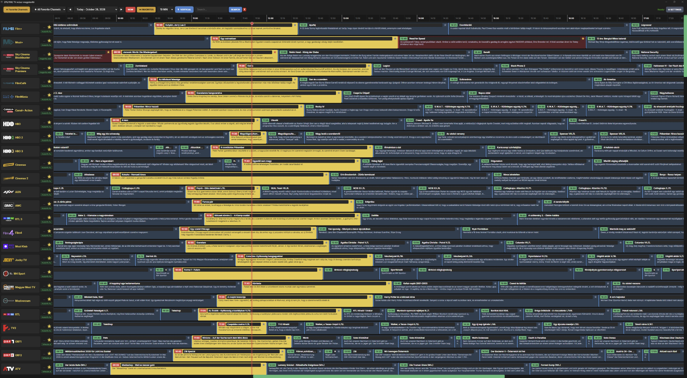
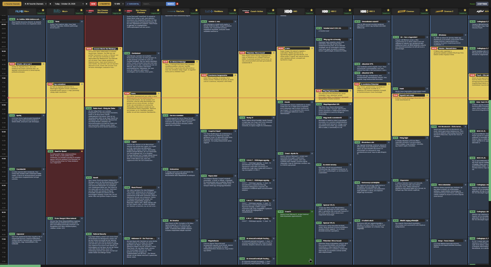
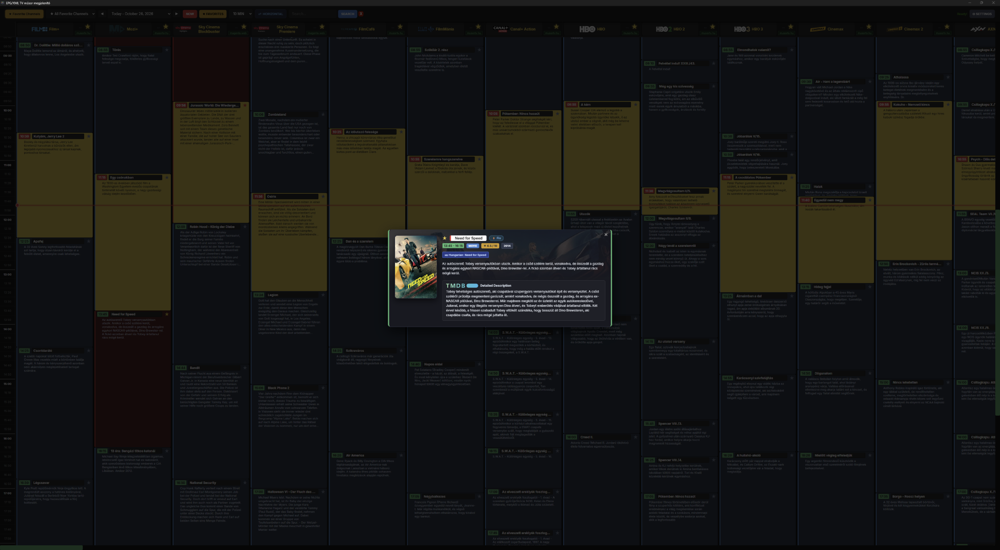
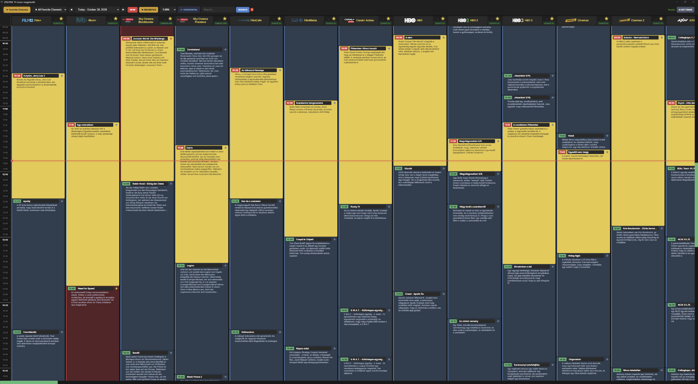
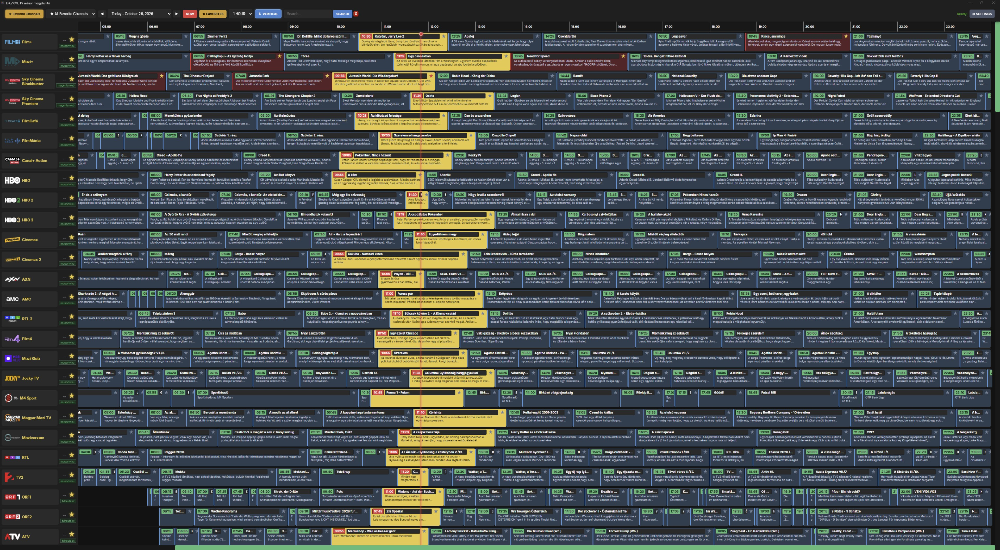
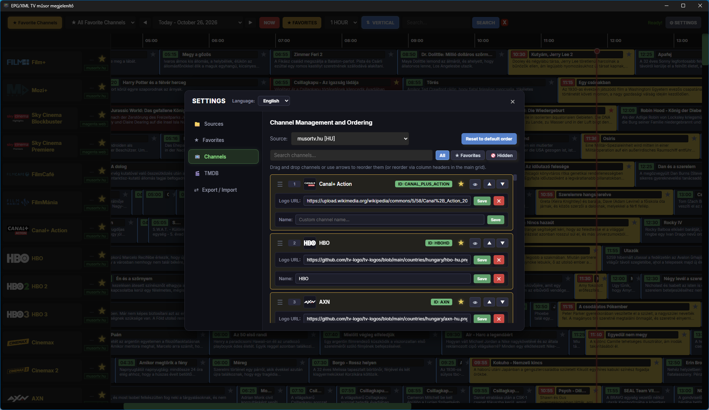
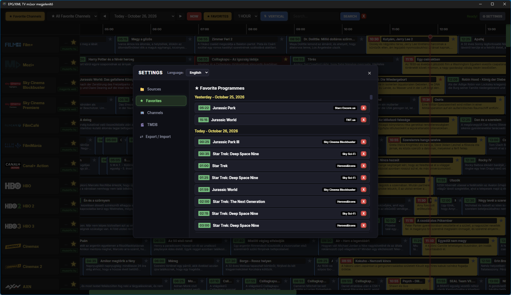
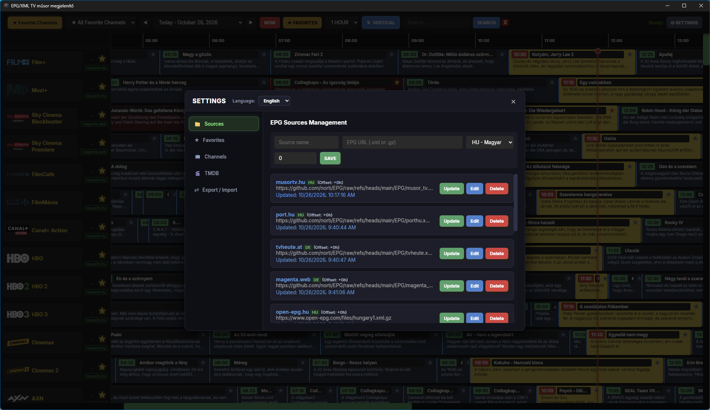

# EPG Viewer

[English](README.md) | **Magyar**

Fejlesztés alatt... Az első verzió megjelent.

## Letöltés (Windows x64)

- **[Legfrissebb telepítő letöltése (Windows x64)](https://epg.norti.workers.dev/download/latest)** _(Cloudflare R2)_
- **[Változásnapló](CHANGELOG.md)** · **[Kiadások](https://github.com/norti/epg-viewer/releases)**

---

## Licenc és jogi nyilatkozatok

A szoftver forráskódja az [MIT Licenc](LICENSE) hatálya alá tartozik.

### Harmadik felek védjegyei és csatornalogók

A megjelenített televíziós csatornanevek, logók és márkajelzések a megfelelő műsorszolgáltatók és védjegytulajdonosok tulajdonát képezik. A logók megjelenítése az elektronikus műsorújságban (EPG) kizárólag azonosítási és tájékoztatási célokat szolgál (_nominative fair use_).

A szoftver forráskódja és telepítőcsomagja nem tartalmaz előre becsomagolt csatornalogókat. A logók futásidőben, a felhasználó kérésére kerülnek lekérésre nyilvános külső forrásokból, és kizárólag a felhasználó saját számítógépén (helyi SQLite adatbázisban) kerülnek gyorsítótárazásra.

### Felhasznált külső források

- **tv-logo/tv-logos:** Sötét hátterekre optimalizált TV-csatorna logók (https://github.com/tv-logo/tv-logos)
- **iptv-org/database:** Nyílt IPTV adatbázis és csatornajegyzék (https://github.com/iptv-org/database, CC0 1.0 Universal)
- **Wikimedia Commons:** Szabad médiafájlok és vektoros SVG logók (https://commons.wikimedia.org)
- **Trakt.tv API:** Műsorkövetés, Watchlist, naptár és értékelések (https://trakt.tv). _EPG Viewer uses Trakt but is not endorsed or certified by Trakt._
- **TMDB (The Movie Database):** Film- és sorozatmetaadatok, poszterek és magyar leírások (https://www.themoviedb.org). _This product uses the TMDB API but is not endorsed or certified by TMDB._

### UI ikonok

A felhasználói felületen alkalmazott vektoros ikonok a **Tabler Icons** gyűjteményből származnak (https://tabler.io/icons), melyek az MIT Licenc feltételei szerint használhatók.
