# EPG Viewer

**English** | [Magyar](README.hu.md)

Under development... Initial version released.

## Download (Windows x64)

- **[Download latest installer (Windows x64)](https://epg.norti.workers.dev/download/latest)** _(Cloudflare R2)_
- **[Changelog](CHANGELOG.md)** · **[Releases](https://github.com/norti/epg-viewer/releases)**

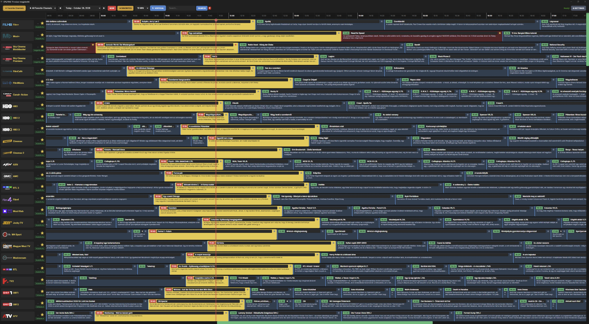
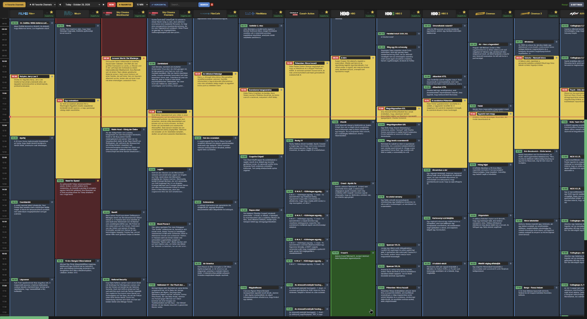
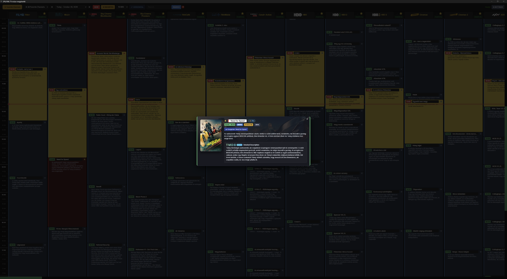
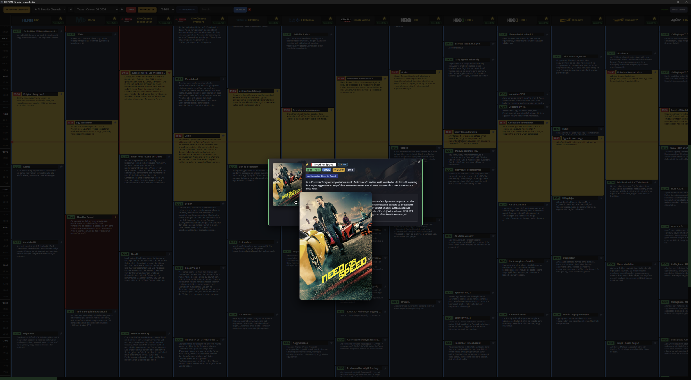
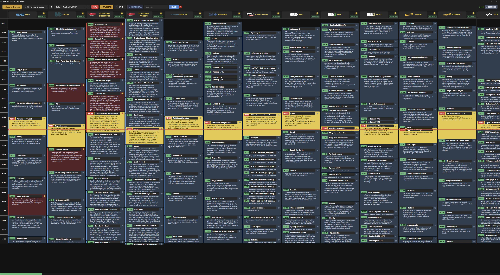
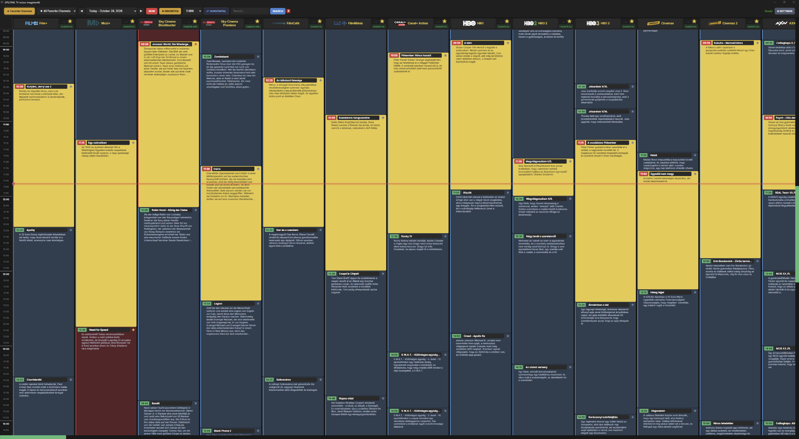
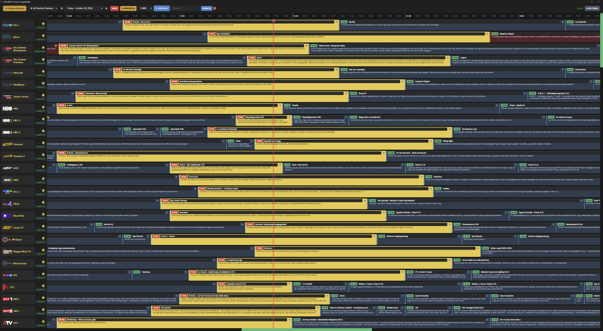
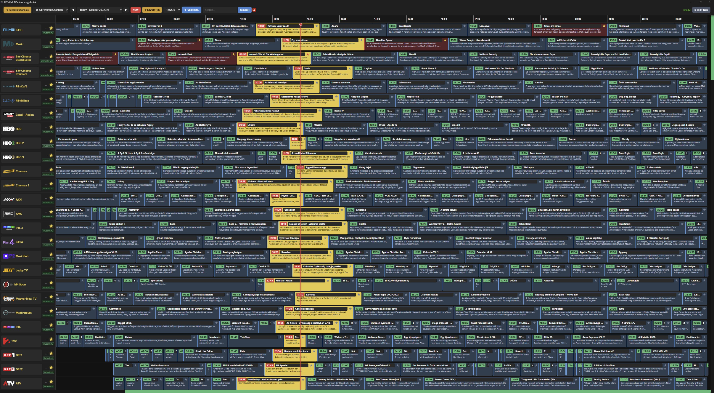
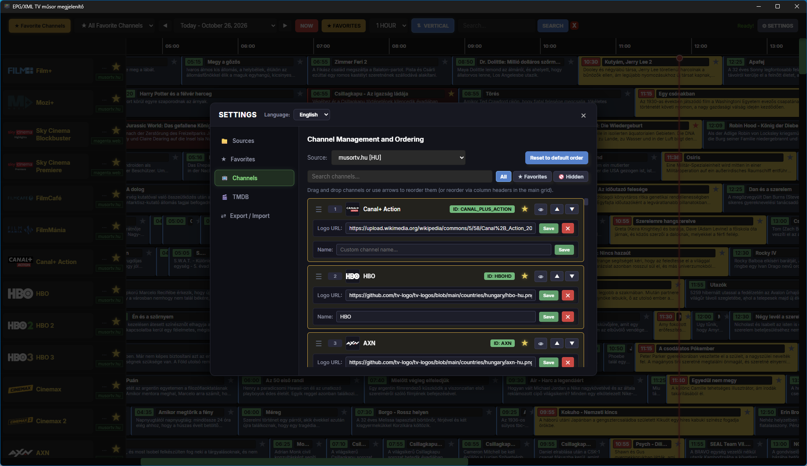
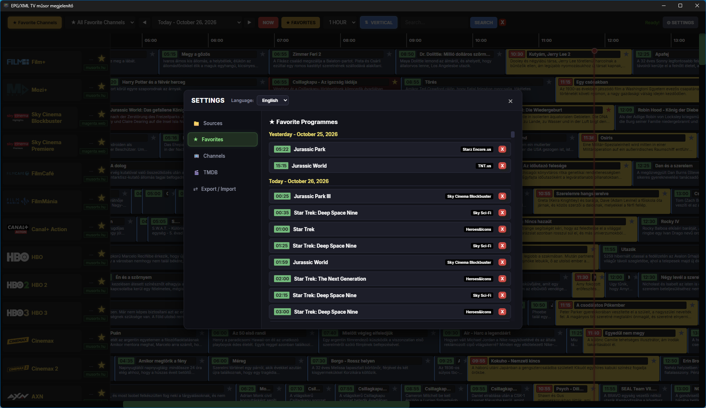
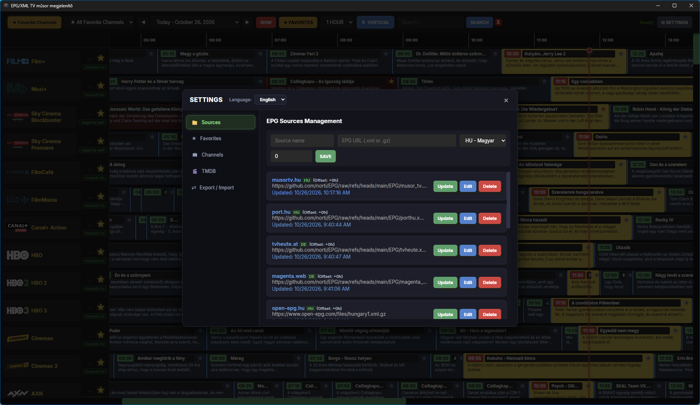

---

## License & Disclaimers

The source code of this software is licensed under the [MIT License](LICENSE).

### Trademarks & Channel Logos

All displayed television channel names, logos, and brand marks are the property of their respective broadcasters and trademark owners. Channel logos are displayed in the electronic program guide (EPG) solely for identification and informational purposes (_nominative fair use_).

Neither the source code nor the installer package bundles any channel logos. Logos are fetched at runtime on user request from public external sources and cached exclusively on the user's own computer (in a local SQLite database).

### Data Sources

- **tv-logo/tv-logos:** TV channel logos optimized for dark backgrounds (https://github.com/tv-logo/tv-logos)
- **iptv-org/database:** Open IPTV database and channel directory (https://github.com/iptv-org/database, CC0 1.0 Universal)
- **Wikimedia Commons:** Free media files and vector SVG logos (https://commons.wikimedia.org)
- **Trakt.tv API:** Show tracking, Watchlist, calendar, and ratings (https://trakt.tv). _EPG Viewer uses Trakt but is not endorsed or certified by Trakt._
- **TMDB (The Movie Database):** Movie and TV show metadata, posters, and localized descriptions (https://www.themoviedb.org). _This product uses the TMDB API but is not endorsed or certified by TMDB._

### UI Icons

The vector icons used in the user interface come from **Tabler Icons** (https://tabler.io/icons), licensed under the MIT License.
