# EPG Viewer

Under development...

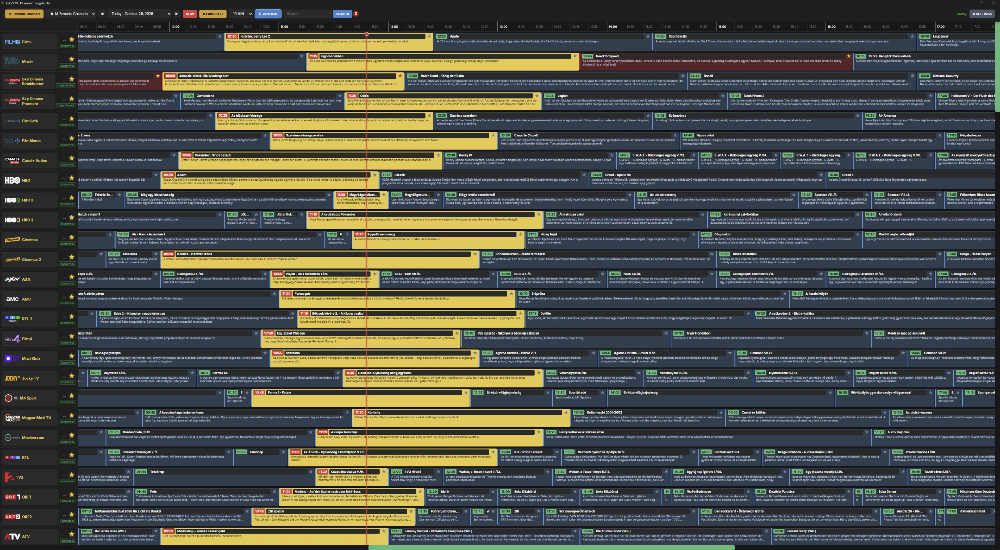
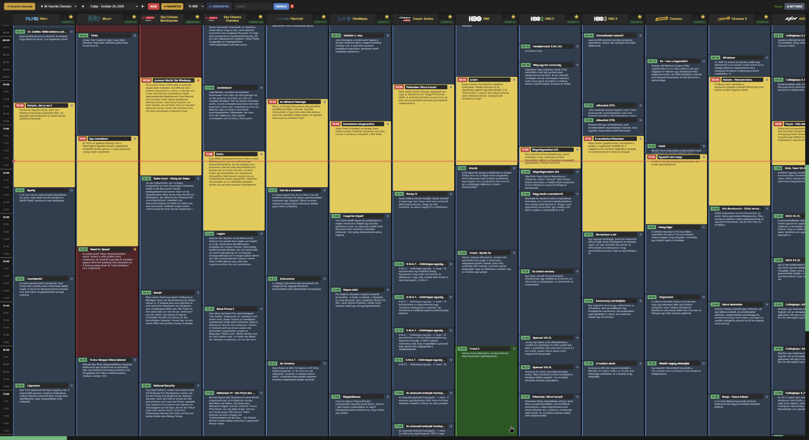
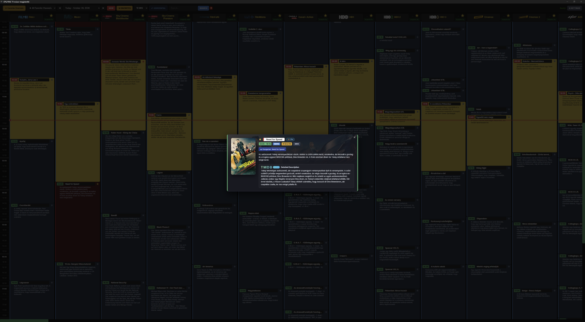
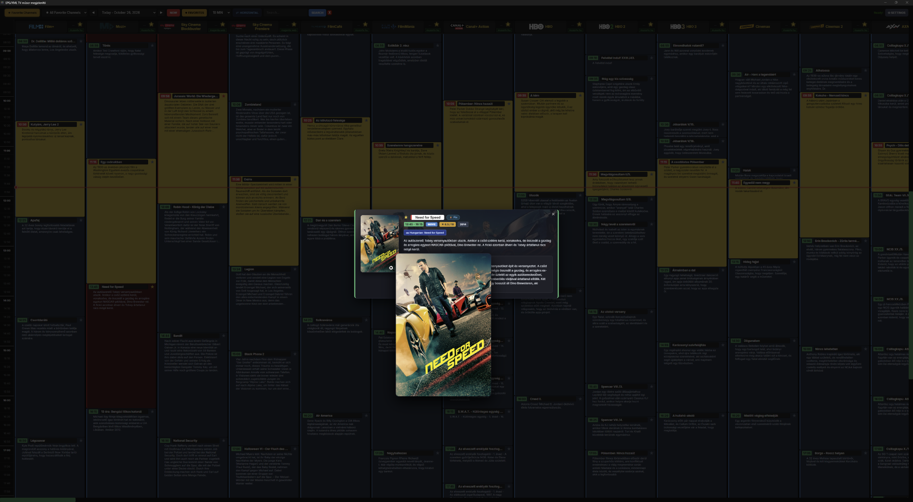
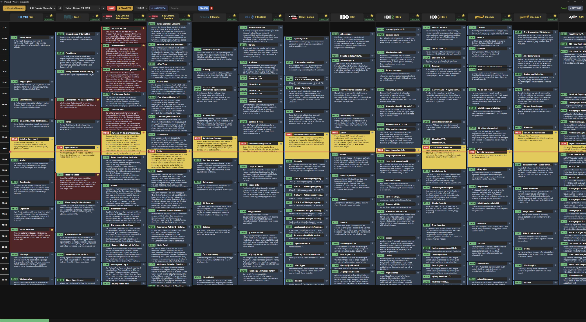
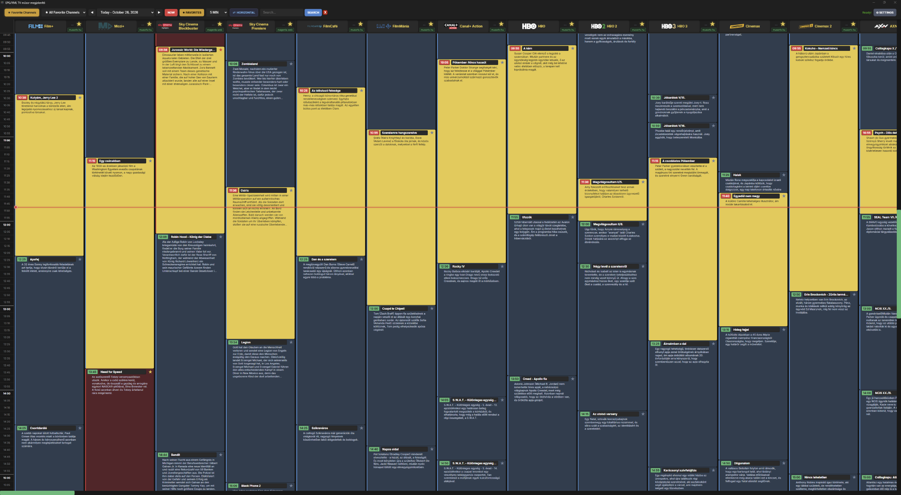
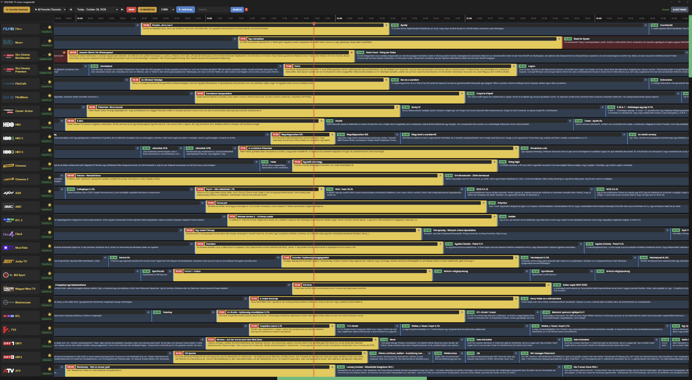
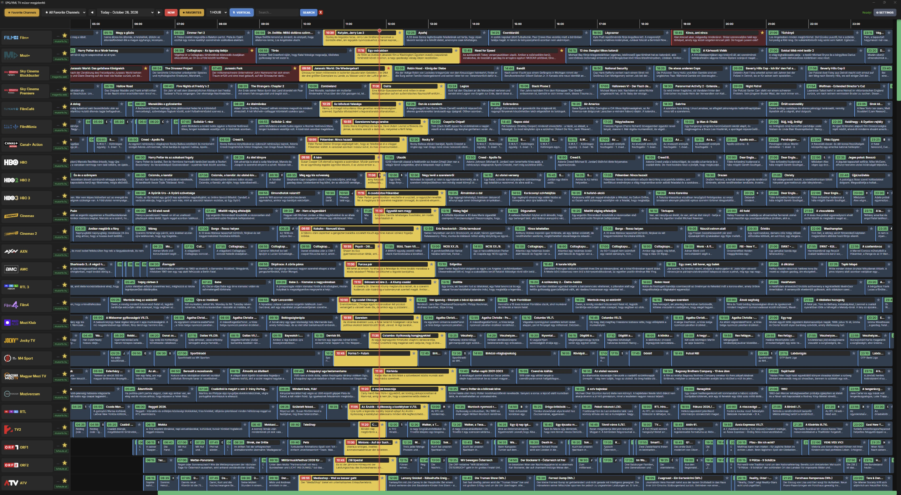
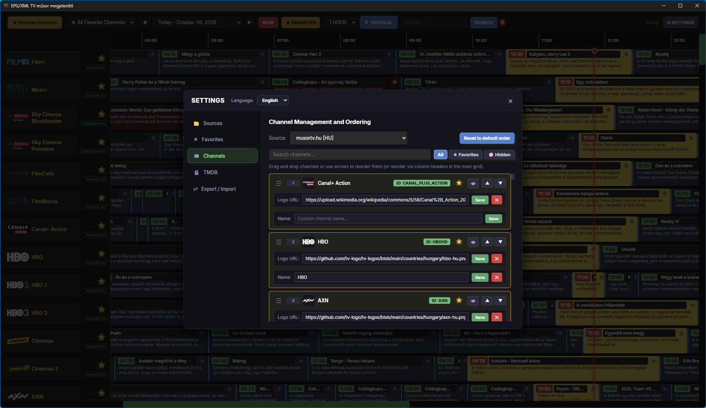
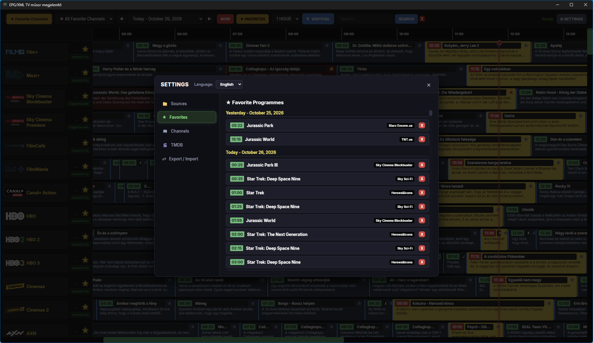
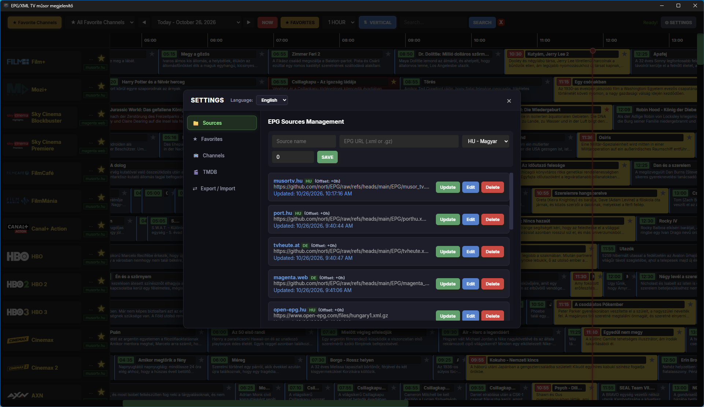

---

## Licenc és Jogi Nyilatkozatok (License & Disclaimers)

A szoftver forráskódja az [MIT Licenc](LICENSE) hatálya alá tartozik.

### Harmadik felek védjegyei és csatornalogók (Trademarks & Channel Logos)
A megjelenített televíziós csatornanevek, logók és márkajelzések a megfelelő műsorszolgáltatók és védjegytulajdonosok tulajdonát képezik. A logók megjelenítése az elektronikus műsorújságban (EPG) kizárólag azonosítási és tájékoztatási célokat szolgál (*nominative fair use*).

A szoftver forráskódja és telepítőcsomagja nem tartalmaz előre becsomagolt csatornalogókat. A logók futásidőben, a felhasználó kérésére kerülnek lekérésre nyilvános külső forrásokból, és kizárólag a felhasználó saját számítógépén (helyi SQLite adatbázisban) kerülnek gyorsítótárazásra.

### Felhasznált külső források (Data Sources)
- **tv-logo/tv-logos:** Sötét hátterekre optimalizált TV-csatorna logók (https://github.com/tv-logo/tv-logos)
- **iptv-org/database:** Nyílt IPTV adatbázis és csatornajegyzék (https://github.com/iptv-org/database, CC0 1.0 Universal)
- **Wikimedia Commons:** Szabad médiafájlok és vektoros SVG logók (https://commons.wikimedia.org)

### UI Ikonok (Icons)
A felhasználói felületen alkalmazott vektoros ikonok a **Tabler Icons** gyűjteményből származnak (https://tabler.io/icons), melyek az MIT Licenc feltételei szerint használhatók.
